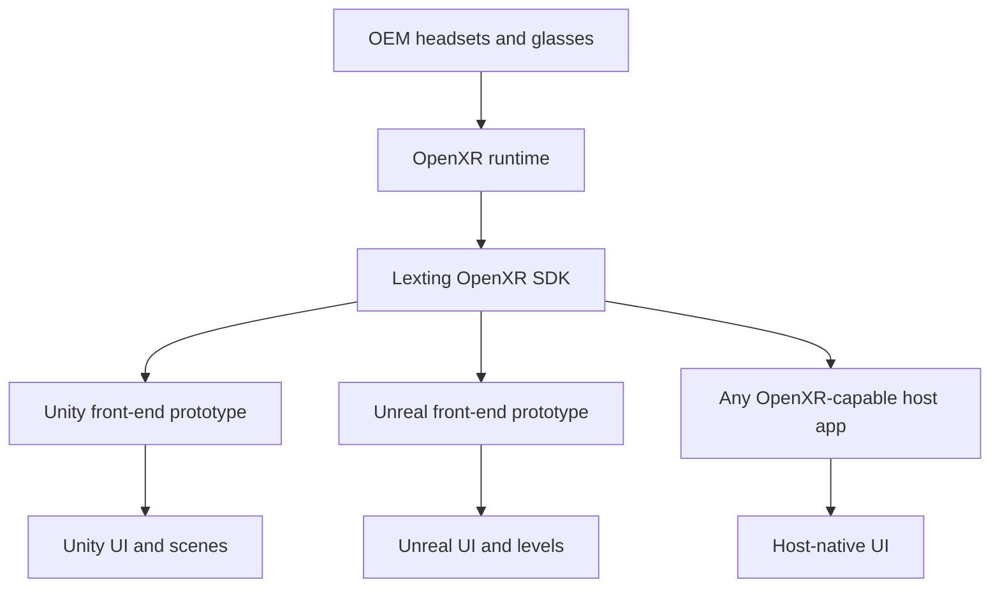
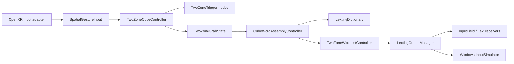

# Lexting: Type Words, Not Letters
## Rapid Spatial Gesture Text Input for XR

[](https://www.khronos.org/openxr/)
[](Lexting_Unity/ProjectSettings/ProjectVersion.txt)
[](docs/implementation_plan.md)

**Current milestone:** [`0.2.0`](docs/implementation_plan.md) — Unity plugin packaging (Milestone 2). Quest 2 typing parity for the dual-volume widget is signed off on **`0.1.0`** / build **028**; this repo still ships the **`Lexting_Unity/`** monolith while **`Lexting_Unity_Plugin/`** is extracted.


 3-Minute Tutorial Coming Soon


**Lexting** is an **OpenXR** spatial text-entry interface controlled with either hand or both hands. Each hand gets a **2×2×2 typing volume** (eight letter **nodes** each) floating in front of the wrist. To type faster than any other mid-air XR text entry method, you **grab**, **drag**, and **turn your wrists** in a single group gesture that maps to a whole word in English in under 0.5 seconds, yielding theoretical average speed limit above 120WPM for power users. Each gesture includes instant conjugation and punctuation capability. Hotkeys, numbers, special characters, and other ASCII features are avilable, and streamed keystrokes are currently able to provide remote input to Windows PCs in addition to game engine integration via SDKs. The **Unity SDK** is avaialble in 1.0. **Unreal SDK** and **OpenXR Direct SDK** will be avaialble in 2.0.

<hr style="border: 1px solid gray;">

<a id="introduction"></a>
<details>
<summary><b>🧊 Introduction</b></summary>
<hr style="border: 1px solid gray;">

<blockquote>
<details>
<summary><b>🌐 What is Lexting?</b></summary>
<hr style="border: 1px solid gray;">

Lexting is a rapid volumetric isotropic **hands-first XR text entry** system with no physical keyboard or furniture necessary. It is designed for competitive-speed text entry in spatial computing that works universally for users while sitting, standing, or even walking. It is especially needed as a replacement for ridiculously slow floating QWERTY UIs in XR since it is the only alternative that needs no tabletop, yet it can rival physical QWERTY throughput. Instead of typing keys one at a time on a flat QWERTY layout, you:

1. **Hover** into **nodes** inside each hand’s typing **volume** using an isotropic **hand cursor** so the real hand does not have to intersect and occlude the 3D widget.
2. **Grab** to type a letter or grab-hold to activate a whole word.
3. **Drag** across **nodes** to assemble up to **four letters** across both hands in one rapid dual-hand gesture.
4. **Filter** against an English dictionary in real time. Other languages will be supported in the future.
5. Release one hold of two to begin Finalization. **Finalize** the root word in the left hand volume, **conjugate** with dual-hand wrist orientations, and **punctuate** from the right-hand **volume**.
6. **Emit** text to subscribed `InputField` / `Text` components, or synthesize **Windows keyboard** input when running in PC passthrough / keyboard-replacement modes.

The primary reference implementation is the **dual-volume typing widget** (`TwoZoneCubeController`). Several layouts of various node counts, matrix types, and letter positions were tried and then deprecated in favor of this 2x2x2 matrix for each hand.

</details>
</blockquote>

---

<blockquote>
<details>
<summary><b>📜 Background</b></summary>
<hr style="border: 1px solid gray;">

<details>
<summary style="font-size: 1.15em; display: list-item;"><span style="font-weight: 600;">The Point of Inception</span></summary>

Lexting was invented in January 2020 by AJ Campbell (scifiuiguy on GitHub). It was originally born out of his attempt to build a 3D visual programming language called Atomic. In the first week of developing Atomic, it became very clear that an iconographic node-based 3D programming language (a 3D VPL) was going to need lots of text entry capability despite wanting to turn all text-based code into 3D clusters of simple geometry. 3D VPLs are a primary use case for XR 2.0. They will feature complex floating clusters of synapse-like content in 3D space that require a user to engage while standing up in an open space without a desktop in the way. This use case exposed the pitfalls of slow QWERTY XR text entry like no other.

</details>

<details>
<summary style="font-size: 1.15em; display: list-item;"><span style="font-weight: 600;">Floating QWERTY, A Familiar Problem</span></summary>

Having worked at Magic Leap, AJ was very familiar with how poorly floating QWERTY keyboards perform in spatial computing in general. He struggled with the jank of floating QWERTY for years, building multiple QWERTY alternatives along the way. No previous prototypes felt competitive with physical QWERTY, but AJ knew SOMETHING was out there, some overlooked idea that would unlock competitive typing speed. In the years since he brainstormed Lexting, he has come to understand through a habit of binge-reading ancient XR HCI research papers that the overlooked idea is clear in retrospect: **volumetric isotropic interface design**. AJ believes isotropic interfaces will largely replace today's "modern" XR interfaces (all based on **raycast perspective projection**). Isotropic interfaces hold all the keys that explain why Lexting is awesome, and MUCH faster than floating QWERTY.

</details>

<details>
<summary style="font-size: 1.15em; display: list-item;"><span style="font-weight: 600;">XR 1.0 Interfaces</span></summary>

AJ finds **raycasting** useful solely as a backwards compatibility tool for 2D legacy app support in XR. Most of his modern interface design work features **volumetric isotropic elements** instead of raycast cursors on flat planes. AJ believes **raycast cursors on flat-surface-based WIMP metaphors** are the key design choices that will make XR 1.0 interfaces look incredibly dated in a few years as they are largely replaced by **rapid-speed volumetric isotropic interfaces in XR 2.0**.

</details>

<details>
<summary style="font-size: 1.15em; display: list-item;"><span style="font-weight: 600;">Lexting was the First 3D Isotropic Text Entry Solution</span></summary>

Lexting was the first fully volumetric isotropic interface AJ ever designed. The idea is not new, but it **IS** a forgotten art. Volumetric isotropic techniques were quite popular in 1990s XR HCI research, but Academia moved away from them under certain false assumptions that constraining control to X and Y were better/faster/easier, and industry took their lead and built raycast+WIMP into the core of every OS. The enitre XR community (both Academia and Industry) went **down the raycast+WIMP rabbit hole**, and Lexting is the prime example as to why **it was the wrong rabbit hole**.

</details>

<details>
<summary style="font-size: 1.15em; display: list-item;"><span style="font-weight: 600;">Highest-Throughput Need = 1st Domino to Fall</span></summary>

Text entry is THE quintessential use case for which throughput is most needed. The XR industry as a whole used raycast+WIMP to put up the floating QWERTY UI as the champion interface. By happenstance, AJ stumbled upon forgotten volumetric isotropic techniques and used them to put up Lexting, which absolutely destroys floating QWERTY on throughout. This is just one early example of how EVERY raycast+WIMP UI will eventually be destroyed by volumetric isotropic equivalents in apples-to-apples throughput competition, hence the inevitable transition from XR 1.0 to XR 2.0.

</details>

<details>
<summary style="font-size: 1.15em; display: list-item;"><span style="font-weight: 600;">We Can't Do The Greatest Things in XR Without Higher Throughput</span></summary>

With 3D VPLs and other complex data visualization tools on the horizon, there was no way to put up with slow interfaces anymore, especially slow text entry. Floating QWERTY would ruin the purpose of any fast-paced node-based 3D VPL, and the same is true of any 3D situation in which large clusters of individual pieces of content or data must be arranged and controlled rapidly. XR 2.0 will have a lot more data cluster management capability because newer interfaces will enable that higher level of 3D throughput for the first time. But the cart has to come before the horse. That's why AJ sidelined the entire Atomic project to solve the QWERTY problem instead. Little did AJ know COVID was about to hit the world like a bomb, leaving an opening for Lexting to take over his every waking thought for the following two years.

</details>

<details>
<summary style="font-size: 1.15em; display: list-item;"><span style="font-weight: 600;">All For Nothing?</span></summary>

Unfortunately, after two years of changing the layout over and over until it felt perfect, COVID had sent the entire XR industry running for the hills. It felt as though very few people were interested in trying the private beta once it was finally approaching a stable state. The disinterest was a wild contrast to the fervor of the 20-teens, but AJ assumed the XR market would roar back one day, as it always has in past cycles. He decided to shelve Lexting until that day felt closer.

</details>

<details>
<summary style="font-size: 1.15em; display: list-item;"><span style="font-weight: 600;">Are We There Yet?</span></summary>

The next XR hype cycle feels closer now in 2026. We have world-meshing HMDs that are **ALMOST sunglasses form factor** now, whispers of **XR app multitasking** on the horizon (an absolute necessity for XR adoption in offices), and **containerization** has taken the cloud by storm, unlocking edge compute bottlenecks. The ingredients are in place for XR 2.0. Now we just need a wicked-fast 3D text entry solution. A wicked-fast OS UI couldn't hurt either (see 3OS). AJ told a few people he'd open-source Lexting eventually, since there were dozens who expressed interest without any marketing. Q4 2026 is finally the time to get back on it. Let's do this!

</details>

</details>
</blockquote>

---

<blockquote>
<details>
<summary><b>⚙️ How Does It Work?</b></summary>
<hr style="border: 1px solid gray;">

<details>
<summary style="font-size: 1.15em; display: list-item;"><span style="font-weight: 600;">Warm Up: Breathe In The Nature of Your Arm's Flexing Capabilities</span></summary>

The elbows should always be near the ribs, but not tucked or pressed into the body. Just like the hundreds of drum students AJ taught when he was in college, he encourages anyone using Lexting to start by rolling those shoulders out and shaking those elbows loose so you can feel them flopping lifelessly. That looseness is how they should stay. Hold on to that relaxation as you put your hands into starting position. It's scientifically proven that we all flex a whole bunch of our muscles for no reason whenever we try something new, so it's best to start each Lexting session with a quick reminder to shake all of that tension out before you begin. Every shoulder muscle should be ready for bed through the whole session. Only a tiny flex of the biceps is needed to bring hands up into starting pose.

</details>

<details>
<summary style="font-size: 1.15em; display: list-item;"><span style="font-weight: 600;">Starting Pose</span></summary>

The starting pose is elbows completely neutral, and the elbows are never meant to move more than three inches forward or three inches back during Lexting use, for a total z-depth range of 6". Neutral elbow should put cursors directly into the center core of each hande node in the UI. If not, then the UI or the body needs to adjust. Elbow never moves laterlaly away from the ribs, only forward and backward. Lateral elbow motion flexes the deltoid (shoulder cap) for absolutely no reason.

</details>

<details>
<summary style="font-size: 1.15em; display: list-item;"><span style="font-weight: 600;">Starting Hands</span></summary>

From neutral elbows, you point both wrists and all fingers out straight ahead, palms facing each other. This palms-sideways position is the absolute most relaxed/unflexed position for your ulnar wrist muscles, which is important for Lexting, since you twist the wrists for activating modes.

</details>

<details>
<summary style="font-size: 1.15em; display: list-item;"><span style="font-weight: 600;">Wrist Warm-up</span></summary>

Before trying to type, release all finger tension. The fingers will curl slightly, pointing toward each other. Now feel the wrist muscles flex as you turn both palms downward (pronate). Feel them release back to sideways. Feel them flex to turn palms up (supinate). Feel them release to sidways. Sideways is home because sideways is muscle release.

</details>

<details>
<summary style="font-size: 1.15em; display: list-item;"><span style="font-weight: 600;">The UI</span></summary>

Each hand alone has an 8-cell 2x2x2 cube to itself, which displays eight letters at once, one in each cell. Pronate to change to a different set of 8 letters. Supinate to change to yet a different set. These three wrist positions give you 24 letters. The final two letters in the English alphabet are the least common in the dictionary (X and Z) so we place them in the UI's overflow area, which you can access by turning the palm slightly forward with fingers pointings slightly upward. X and Z become avaialble in the overflow area (the bottom rear two cells).

</details>

<details>
<summary style="font-size: 1.15em; display: list-item;"><span style="font-weight: 600;">Basic Activation</span></summary>

To activate a node, you can set Lexting in either **Pinch Mode (index-to-thumb)** or **Grab Mode (close all four fingers against the palm)**. AJ prefers Grab Mode because it enables all four inline fingers to work together, which requires less coordination. You can tell it's easier because moving any one inline finger alone is actually quite challenging, even the index finger. All four inline fingers WANT to move together, and you have to train muscle memory to coordinate them apart. It's why baby's can whole-hand-grab things even before they're out of the womb but a single finger pinch is hard for an infant. Our most fundamental motor cortex synapses trained the whole-hand-grab first. It might seem like it requires more muscle, but take it from a drum teacher... you can move all four fingers rapidly in tandem all day long without fatigue as long as you don't flex too hard.  In Pinch Mode, a pinch types a single letter. In Grab Mode, a grab types a single letter. The README from here on will only mention grab for activation. That said, if you prefer Pinch Mode over Grab Mode, it is a toggleable option.

</details>

<details>
<summary style="font-size: 1.15em; display: list-item;"><span style="font-weight: 600;">Word Mode</span></summary>

Lexting is built around two phases: **word mode** (assemble a letter prefix) and **finalization mode** (pick the dictionary word type, grammar, and punctuation).

Start with a **grab** in both hands when you're hovering over the first to letters of your word. Tentative output appears above the **volumes**. You can add a **third and fourth** letter by moving either hand. The dictionary filters to the top result in real time.

</details>

<details>
<summary style="font-size: 1.15em; display: list-item;"><span style="font-weight: 600;">Finalization Mode</span></summary>

When eight or fewer roots match, matching words fill the **left volume** as **nodes**. Hover a root, set **conjugation** with **two-hand wrist orientation** (`LextingConjugationState`), and pick **punctuation** from **nodes** on the **right volume**. **Soft-tap** (open-hand tap) cycles alternate forms in the same conjugation group. Release the remaining grab to **commit** the word.

</details>

</details>
</blockquote>

---

<blockquote>
<details>
<summary><b>⌨️ Why not QWERTY?</b></summary>
<hr style="border: 1px solid gray;">

The real sole competitor is not physical QWERTY nor projected virtual QWERTY nor stenography, although Lexting draws deep influence from them all. The sole competitor is floating virtual QWERTY, since floating QWERTY is the only option other than Lexting that works in mid-air.


<details>
<summary style="font-size: 1.15em; display: list-item;"><span style="font-weight: 600;">QWERTY versus Stenography</span></summary>
Flat floating **QWERTY in XR** is a pain even for the occasional one-off keyword search, but it is an absolute deal-breaker for enterprise productivity typing, whereas **Stenography** is to go-to professional tool that requires years of training for best-in-class throughput, yet most office workers can't cross its huge learning curve or deal with its expensive closed-source hardware. Lexting aims to borrow techniques from both QWERTY and steno to create a best-of-both-worlds on speed versus ease to learn. Lexting uses steno-style chording techniques to destroy floating QWERTY. It probably competes neck-and-neck with physical QWERTY, yet it's easier to learn than QWERTY, let alone MUCH easier than Stenography. 

</details>

<details>
<summary style="font-size: 1.15em; display: list-item;"><span style="font-weight: 600;">Spatial Computing in Mid-Air</span></summary>

Productive rapid spatial text entry **IS** possible within the volume in front of your upper torso—but not on a virtual floating QWERTY panel. Vice versa, You **COULD** use Lexting at a physical desk, but there will tyipcally be little need when physical QWERTY is already there and familiar in most cases. Lexting provides a 3D widget **attached to the upper body** so it works **sitting, standing, or walking,** making it the most flexible competitive option. That said, roomscale standing with no table in the way is its default use case.

</details>

<details>
<summary style="font-size: 1.15em; display: list-item;"><span style="font-weight: 600;">Occlusion and Periphery</span></summary>

Poking individual keys with tracked fingers means your hand covers the very target whose hover and selection highlights are crucial peripheral indicators for picking up speed. Mobile devices use popover tooltips to reveal whether you hit the right key, but that only works when the line of sight is inches away from the output text that is supposed to retain eye focus. Lexting uses an offset **hand cursor** and **volumetric nodes** so selection stays perfectly perceptible, making "touch-typing" feasible even though there's nothing physical to touch. It's periphery typing instead of touch-typing, but the goal is identical: let the eyes stay on the output. Volumetric isotropic controls let you place the cursors IN the nodes, not on them (volume-based not surface-based), and unique hover/selection aesthetics plus audio cues are geared toward aiding peripheral control. Lexting expects sightline to stay on the output while the widget provides crucial peripheral feedback that doesn't even need a glance.

</details>

<details>
<summary style="font-size: 1.15em; display: list-item;"><span style="font-weight: 600;">Isotropic 3D Layout</span></summary>

Unlike QWERTY, an inherently 2D layout, Lexting letters live on a **cubic 3D lattice** around each wrist, not on a 2D row copied from a typewriter. That matches wrist rotation and grab-and-drag motion instead of forcing every symbol onto a flat plane. This maximizes adjacency, leading to smallest possible hand travel distance, which yields top throughput and ergo comfort.

</details>

<details>
<summary style="font-size: 1.15em; display: list-item;"><span style="font-weight: 600;">The Layout is Designed For Error Prevention</span></summary>

The eight-cell multi-choice widget with a neutral core was chosen after many iterations of various layouts, many of which performed at high speed but killed their own total throughput by being too error-prone. The eight-cell system is that perfect Goldilocks arrangement for 3D hand motion. It eliminates all overshoot and undershoot errors because, for each node-to-node motion, there are essentially no intermediate stopping point options, which means it's nearly impossible to overshoot your target even without looking. Beginners can move their hands in big, exaggerated actions and still not miss. Power users can practice shrinking the total travel distance over time to pick up speed. In contrast, there is no way to type with floating XR QWERTY without looking.

</details>

<details>
<summary style="font-size: 1.15em; display: list-item;"><span style="font-weight: 600;">Chordal Throughput</span></summary>

Floating QWERTY in VR is still largely **one symbol per discrete action**. Without a tactile surface to work against, it can never match even a fraction of physical QWERTY speed. Chordal alternatives are a necessity to get that speed back. Lexting assembles up to **four letters per dual-hand gesture** in Word Mode (which engages as soon as the user begins using two hands in tandem). It's like snatching a word out of the air by grabbing four letters all in one quick motion. The word resolves from a **dictionary**—often appearing immediately, or presenting a short list of word choices. This is a hybrid best-of-both-worlds between QWERTY and Stenograophy. It's a chordal system with all the speed of QWERTY without the years of memorization needed for stenography.

</details>

<details>
<summary style="font-size: 1.15em; display: list-item;"><span style="font-weight: 600;">Language and form, not just alphabet</span></summary>

Conjugation and punctuation are **first-class gestures** (wrist pose + right-hand **volume**) that can be baked into each word in the same gesture that created the word, making extra prefixed gestures, postfixed gestures, extra letters, and modifier keys unnecessary.

</details>

<details>
<summary style="font-size: 1.15em; display: list-item;"><span style="font-weight: 600;">Lexting Knows Its Niche</span></summary>

Lexting is **not** claiming QWERTY is useless in XR. The author assumes QWERTY will remain king as long as there is a flat desktop available on which to place the physical hardware. The author of Lexting also finds projected virtual QWERTY to be an interesting solution, although it seems like a vast majority of its use cases are better served by a physical QWERTY since both require a desktop. The author of Lexting imagines a future for most offices where rolling standing desks enable everyone to bring a physical QWERTY keyboard anywhere in the room while engaging with volumetric content. However, sometimes even a small rolling desk will feel "in-the-way." There must be a way to continue typing rapidly in mid-air. Lexting is the way. If it gains only 20 million power users by 2080, it will have grown faster than QWERTY did. By then, who knows if we have ANY 2D screens? Will QWERTY still be around? If not, how text without Lexting?

</details>

</details>
</blockquote>

---

<blockquote>
<details>
<summary><b>📈 Isn't There A Big Learning Curve?</b></summary>
<hr style="border: 1px solid gray;">

There **IS** a learning curve, but it's a shorter curve than **QWERTY** and a MUCH shorter curve than **Stenography** even though it performs like a best-of-both-worlds between the two.

<details>
<summary style="font-size: 1.15em; display: list-item;"><span style="font-weight: 600;">Far fewer total hand motions</span></summary>

Unlike QWERTY, you don't seek ONE-letter-with-ONE-stroke. You grab four letters all at once in a single stroke. Lexting is much closer to Stenography in this fashion, since it is intended to be chordal by default for most gestures. Via **word mode** (i.e. two hands working together for one gesture), you snatch just enough info to steer the **dynamic dictionary** toward your word, and then that word is always in the same spot in the UI. Finalization (subtle twists of the wrist) enables you to postfix your word before you let go of that same gesture. One stroke gets you a whole word every time.

</details>

<details>
<summary style="font-size: 1.15em; display: list-item;"><span style="font-weight: 600;">The eight-node volume is deliberately forgiving</span></summary>

Each hand’s **2×2×2** grid prevents overshoot, which is common in almost any other layout in 3D space, including QWERTY. Beginners can use **large, exaggerated** hand paths and still land in the correct node; speed comes from recognizing those paths can be shortened over time.

</details>

<details>
<summary style="font-size: 1.15em; display: list-item;"><span style="font-weight: 600;">Chordal speed without memorization tax</span></summary>

Stenography pays off with extreme speed, but it demands **years of chord memorization** before it feels natural the letter positions, just like QWERTY, but then it let's you chord like steno right away. Instead of requiring you to know thousands of chords beforehand, you just need to know the first four letters, and your word appears. If you've never typed it before, you can glance down to see where it is among the eight node positions. It will always be in that spot, so your hand will automatically go there after you've typed that word a few times. Lexting takes chordal patterns from a stenography book and bakes them into your spatial muscle memory as you practice typing, rather than making you study a stenography book for years like learning a whole new language.

</details>

<details>
<summary style="font-size: 1.15em; display: list-item;"><span style="font-weight: 600;">Honest expectations</span></summary>

Lexting is much like QWERTY in that you can peck a few letters out at a time right away, but unlocking rapid speed takes practice. It will feel slow at first, then **step-change faster** once word mode, finalization, and peripheral hover feedback start to click as fluid gestures, then gesture sequences. Lexting is geared toward early adopters of enterprise XR who love the idea of working with the whole room as their canvas, on their feet, rather than trapped in a cubicle staring at a 2D screen.

</details>

</details>
</blockquote>

---

<blockquote>
<details>
<summary><b>🧪 What exists in this repo?</b></summary>
<hr style="border: 1px solid gray;">

<details>
<summary style="font-size: 1.15em; display: list-item;"><span style="font-weight: 600;">Core dual-volume typing UI</span></summary>

Main scene: [`Lexting_Unity/Assets/Lexting/_Scenes/main_01_twozone.unity`](Lexting_Unity/Assets/Lexting/_Scenes/main_01_twozone.unity). In-editor documentation for architecture and input setup is stored on **`Descriptor`** components in that scene (large `description` text areas—summarized under [Repository Layout](#repository-layout) and [Architecture](#architecture)).

</details>

<details>
<summary style="font-size: 1.15em; display: list-item;"><span style="font-weight: 600;">Input boundary (OpenXR target)</span></summary>

**Target design:** One **OpenXR** input boundary feeds **`SpatialGestureInput`** (hand/controller poses, gestures, session lifecycle). Everything above that layer—two-volume typing UI, dictionary, hotkeys, output—is runtime-agnostic.

**This repo today:** `LextingInputModuleManager` still exposes legacy **`QUEST_*`** paths alongside **`OPEN_XR`**. Passthrough modes forward text to a Windows PC over the network. The **target** is **OpenXR-first** wiring end-to-end (see [Platform targets](#platform-strategy)).

</details>

<details>
<summary style="font-size: 1.15em; display: list-item;"><span style="font-weight: 600;">English dictionary & conjugation</span></summary>

JSON word lists under `Scripts/EnglishDictionaries/Resources/` feed `LextingDictionary` (four-tier prefix lookup). `LextingConjugationState` maps two-hand wrist poses to grammatical forms during finalization. See [`docs/conjugation_algorithm.md`](docs/conjugation_algorithm.md) for the designer-facing word mode and finalization workflow. It was determined during early R&D that an approximate 10K-word dictionary fits in the default Lexting interface without paging. Even though 100s of 1000s of exotic words exist in English, the first prototype of Lexting is intended to achieve conversational texting with the most popular 10K words in English, along with the ability to add custom words to the dictionary. Larger dictionaries that support paging will be implementaed in the future.

</details>

<details>
<summary style="font-size: 1.15em; display: list-item;"><span style="font-weight: 600;">Demos & tooling</span></summary>

* **QWERTY_Sim** — visualization / comparison demo (`_Scenes/QWERTY_Sim.unity`).
* **Streaming / MLAPI** — experimental Quest→PC streaming (much of the MLAPI code is commented out; see [Streaming & PC passthrough](#streaming)).
* **Tutorial** — in-scene tutorial driven by `TutorialManager` and pop-gun gestures.
* **Speed tests** — `SpeedTestManager` for throughput experiments.
* **Implementation plan** — [`0.2.0` → `1.0.0`](docs/implementation_plan.md) active path (Unity plugin → OpenXR refresh → Meta Start); **`0.1.0`** Quest baseline complete.

</details>

<details>
<summary style="font-size: 1.15em; display: list-item;"><span style="font-weight: 600;">BETA Limitations</span></summary>

Lexting is in Beta. A few primary features have yet to be implemented:

**Long-Word Drill-Down** A small number of words have more than eight potential results once the first four characters are selected, but they don't have more than eight different options for the 5th letter, so if there is only one option for a given 5th letter, then that full word will display in the UI during Finalization. If there is more than one remaining option for that 5th letter, then the first five letters plus "..." will be displayed. If the user hovers on that node and releases Finalization, the first of that group will print, but if the user wants to drill down to other options, they can grab-hold that node to display all the options and move to a different option. The current 1.0 Beta build has no drill-down support yet, so only the first eight options will appear, which means a small number of English words may be impossible to type using Word Mode until Lexting is out of Beta.

**2D Cursor/Caret Control** Control of the 2D caret in a future version of Lexting will turn Lexting into a full-blown word-processing tool rather than just a rapid text input tool. The Caret Control is accessed via Hotkey, and while some of the other Hotkeys e.g. COPY are quite easy to implement, they will not be very useful without a Caret Control to highlight text to copy first. Therefore, most of the Hotkey systems are considered Pending in Beta as they await Caret Control.

**PC Streaming** There is an operational PC streaming service in the Beta, but the Streaming Service itself is brand new in Alpha. It will be throughly tested before Lexting comes out of Beta. 

</details>
</blockquote>

</details>

<hr style="border: 1px solid gray;">

<a id="architecture"></a>
<details>
<summary><b>🏗️ Architecture</b></summary>
<hr style="border: 1px solid gray;">

<blockquote>
<a id="platform-strategy"></a>
<details>
<summary><b>🎯 Platform Targets</b></summary>
<hr style="border: 1px solid gray;">

Lexting is built for **near-field, two-hand** input—the form factor where spatial word entry pays off. OpenXR is the integration layer emerging across the OEMs that will enable long-term cross-platform compatibility long into the future.

The long-term product shape is the **Lexting OpenXR SDK**: hand-tracked typing logic, gesture semantics, dictionary/word pipeline, and output events implemented **once**, on top of **OpenXR** session and hand/controller APIs. **Engine projects are front-end integrations** of that SDK—not separate platform forks.

* **Today (`0.2.0`):** playable **Unity 6** prototype in [`Lexting_Unity/`](Lexting_Unity/) — open the project, build Quest APKs with [`build_quest.ps1`](Lexting_Unity/build_quest.ps1), reference scene **`main_01_twozone`**. Package layout **`Lexting_Unity_Plugin/`** is the M2 deliverable (in progress; Getting Started below describes the target install).
* **Goal:** a matching **Unreal Engine** reference prototype that uses the **same SDK**, so teams can evaluate Lexting in either editor without reimplementing typing behavior.
* **Beyond engines:** any **app or ecosystem that already supports OpenXR** should be able to host the SDK with comparatively thin glue (native, custom engines, enterprise shells, etc.)—the SDK is the portable core; Unity and Unreal are the first-class **sample hosts**.

<blockquote>
<details>
<summary><b>Why OpenXR?</b></summary>

* **One runtime contract** for head pose, hands, controllers, and (where exposed) session and composition—instead of N duplicate SDK forks in the typing stack.
* **OEM convergence:** Meta, Samsung, Valve, XReal, and others ship or plan **OpenXR runtimes**; successful hardware roadmaps align with the spec, not proprietary input silos.
* **Portable core:** Two-volume typing, word assembly, dictionary, and hotkeys belong in the **Lexting OpenXR SDK**; Unity/Unreal layers supply scene graph, UI widgets, and editor workflow only.
* **Integrator freedom:** If your product already loads an OpenXR runtime, you integrate **Lexting** at the SDK boundary—not by porting a whole Unity project.

</details>
</blockquote>

<blockquote>
<details>
<summary><b>Layered architecture (target)</b></summary>



**Meta Quest** remains the **primary dev kit and perf baseline**, accessed as **Meta’s OpenXR runtime**—not as a parallel long-lived platform branch in Lexting.

In this repository, the SDK boundary is **still co-located with the Unity C# codebase** (`SpatialGestureText.*`). The **target** is a hardened SDK boundary that an Unreal front-end (and other hosts) can call through the same OpenXR-facing API.

</details>
</blockquote>

<blockquote>
<details>
<summary><b>Honest gap — what this repo still does</b></summary>

The open-source snapshot predates the consolidation pass:

* **Only the Unity front-end** is present; **Unreal** and standalone **SDK packaging** are roadmap deliverables, not folders in this tree yet.
* **`InputMode.QUEST_*`** and **`OculusHandInput`** still drive most Unity scenes and tests.
* **`InputMode.OPEN_XR`** exists but is not yet the single blessed path in docs, prefabs, and CI.
* Unity packages in [`manifest.json`](Lexting_Unity/Packages/manifest.json) need alignment with **current OpenXR** feature sets (hand tracking, interaction profiles, extensions).

That mismatch is intentional to document: **this README states the OpenXR-first architecture; the tree reflects the current Unity prototype.**

</details>
</blockquote>

<blockquote>
<details>
<summary><b>OEM runtimes we optimize for (via OpenXR)</b></summary>

Hand tracking quality and SKU availability vary; Lexting does **not** fork the UI per vendor. Each row is the **same OpenXR integration path** unless noted.

| OEM / device line | OpenXR notes |
|-------------------|--------------|
| **Meta Quest** (current gen and successors) | Default **development and perf** runtime; validate every release here first. |
| **Samsung Galaxy XR** | **Android XR / OpenXR**; same adapter as other OpenXR Android runtimes when hand APIs stabilize. |
| **Steam Frame** | **OpenXR on SteamVR**; PC VR runtime, shared with other Steam OpenXR devices. |
| **Meta VR Glasses** | **Meta OpenXR stack** when retail glasses expose standard hand or companion-controller input. |
| **XReal Aura** | **OpenXR** plus documented vendor hand extensions mapped into the adapter; glasses fit Lexting’s offset hand cursors well. |
| **Snap Specs** | **Not OpenXR-compatible yet.** The **Lexting OpenXR SDK** will support **Snap Specs as soon as Specs conforms to OpenXR** (or exposes equivalent standard hand/head data). Until then: **roadmap only**—no Specs-specific plugin in this repository. |

</details>
</blockquote>

<blockquote>
<details>
<summary><b>Integration principle</b></summary>

**Do not rewrite typing logic for new hardware or new hosts.** Extend the **Lexting OpenXR SDK** so OpenXR session/hand/controller data flows into the same gesture and word-entry state machine; **Unity** and **Unreal** front-ends only render UI and forward engine-specific text output.

Third-party **apps that already support OpenXR** should integrate the SDK directly when they do not need a full engine sample—same OpenXR boundary, thinner host layer.

Bespoke non-OpenXR shims are **exception-only** (e.g. pre-OpenXR Specs). They belong outside the SDK core and should be removed when the runtime ships conformant OpenXR hand interaction.

</details>
</blockquote>

</details>
</blockquote>

---

<blockquote>
<a id="input-modes"></a>
<details>
<summary><b>🎛️ Input Modes & Setup</b></summary>
<hr style="border: 1px solid gray;">

`LextingInputModuleManager` (`[INPUTS]` object in the hierarchy) selects **`InputMode`**. **Integrators should treat `OPEN_XR` as the long-term default** (see [Platform targets](#platform-strategy)). Legacy **`QUEST_*`** modes remain in the prototype tree for compatibility with existing scenes.

| Mode | Purpose |
|------|---------|
| **`OPEN_XR`** | **Target path:** any conformant runtime—Meta Quest (OpenXR), PC VR, Android XR, **Steam Frame**, **Galaxy XR**, **XReal Aura**, **Meta VR Glasses**, etc. |
| `QUEST_HANDS` | *Legacy prototype:* Quest embedded UI via Oculus-specific hand path. |
| `QUEST_HANDS_PASSTHROUGH` | *Legacy:* Quest passthrough; streams text to a **local PC** over Wi‑Fi. |
| `QUEST_TOUCH` | *Legacy:* Quest Touch controllers. |
| `QUEST_TOUCH_PASSTHROUGH` | *Legacy:* Touch + PC passthrough. |

**Default integrator path:** run **Lexting → Setup Scene** in your open scene ([Getting Started](#getting-started)) **after** you already have an **XR player rig** in that scene (e.g. **XR Origin** / XRI rig with head and hand tracking targets). The wizard writes **serialized** scene content only: **`[INPUTS]`** + **`LextingInputModuleManager`** with **Transform** references into **your** rig. The dual-volume typing widget is **not** saved into your scene hierarchy (see Getting Started).

**Advanced / manual:** assign **head**, **left hand**, and **right hand** on **`LextingInputModuleManager`** yourself only if you are customizing beyond what the wizard provides. Legacy prefabs under [`Lexting_Unity/Assets/Lexting/Resources/Prefabs/InputControllers/`](Lexting_Unity/Assets/Lexting/Resources/Prefabs/InputControllers/) (e.g. **`Lexting_OVRCameraRig`**) remain for prototype Quest workflows; new projects should rely on **OpenXR** + the setup wizard.

OEM coverage—including **Snap Specs** once they ship **OpenXR**—is summarized under [Platform targets](#platform-strategy).

</details>
</blockquote>

---

<blockquote>
<a id="typing-workflow"></a>
<details>
<summary><b>✍️ Word Mode & Finalization</b></summary>
<hr style="border: 1px solid gray;">

The following is adapted from [`docs/conjugation_algorithm.md`](docs/conjugation_algorithm.md) and the word-assembly / finalizer class documentation.

<details>
<summary><b>Word mode Basics</b></summary>

* Word mode starts when **both hands begin a grab in rapid succession**. The first two chosen letters produce dictionary candidates (invalid pairs such as `"XX"` do not enter word mode).
* The tentative word appears above the typing **volume(s)**. The **first and second** characters come from the initial grabs on each hand.
* **Third and/or fourth** characters come from moving dragging into a new **node** with one or both hands.
* Releasing one hand but not the other activates **Finalization Mode**.
* **Popular four-letter roots** (`comp`, `cons`, `cont`, `inte`, `port`, `tran`) require **two extra letters** before finalization—with these special cases, releasing one hand and holding the other will continue to show letters rather than entering finalization mode. This is the system's way of telling you it needs a couple more letters to hone in on your word. These situations are quite rare, but you just need pick one extra letter per hand in this case.

</details>


<details>
<summary><b>Word Mode Composition</b></summary>

**Four letters** merge into a grab cluster as follows:

1. First letter can be grabbed by either right or left hand.
2. Second letter must be grabbed by the opposite hand to begin Word Mode.
3. Either hand moves to a third letter.
4. The opposite hand moves to the fourth letter.

The assembler autocorrects accidntal swaps of the 3rd/4th letters when a mistake does not yield a valid dictionary word, which means the user can blast through a sequence at high speed, and the assembler will almost always give the correct combo the user performed the correct order or not. Only the first two letters need to be ordered correctly in most cases.

To lock in selection, the user releases one hand and holds the other, which activates Finalization Mode.

</details>

<details>
<summary><b>Finalization mode</b></summary>

* When eight or fewer roots match the chosen word cluster, the **left** typing **volume** lists root words (alphabetical).
* Hover the desired root **node**. Optionally set **conjugation** with two-hand wrist orientation (see Conjugation section).
* If multiple conjugations exist for the same orientation, **soft-tap open hand** to cycle (paging dots show group size).
* The **right** **volume** offers **punctuation** while finalizing:

| Node layout (right volume) | Characters |
|-------------|------------|
| Top back | `?` `!` |
| Top front | space, no-space |
| Bottom front | `.` `,` |
| Bottom back | `:` `;` |
| Center | `"` |

* Hover a punctuation **node** with the right hand, then **release the remaining soft hold** to commit the conjugated, punctuated word.

</details>


</details>
</blockquote>

---

<blockquote>
<a id="conjugation"></a>
<details>
<summary><b>🔄 Conjugation</b></summary>
<hr style="border: 1px solid gray;">

During Finalization, while the user is choosing the final word root on the left and optionally selecting a punctuation on the right, they can also turn the wrists at the same time to apply suffixes to turn the word from noun to verb, singular to plural, or even adjective to adverb.

| Left hand | Right hand | `ConjugationState` |
|-----------|------------|---------------------|
| relax | relax | 1st-person singular verb |
| pronate | relax | 3rd-person singular verb |
| supinate | relax | present progressive verb |
| supinate | supinate | past verb |
| relax | pronate | singular noun |
| pronate | pronate | plural noun |
| supinate | pronate | possessive noun |
| relax | supinate | adjective |
| pronate | supinate | adverb |

It is possible for two different wrist gestures to spell the same word because English often takes oddball twists. For example, we commonly use an 's' suffix for both 3rd-person verbs and plural nouns **most of the time** but **not always**, which is why we must have distinct gestures for each. Good examples are "ends-in-f-but-nouns-become-'ves'" words like leaf, wolf, loaf, and scarf.

During finalization, `TwoZoneWordListController` reads the active conjugation key from the dictionary JSON for the hovered root **node**.

</details>
</blockquote>

---

<blockquote>
<a id="hotkeys"></a>
<details>
<summary><b>⌨️ Hotkeys</b></summary>
<hr style="border: 1px solid gray;">

Lexting exposes common word processing commands (copy, paste, backspace, etc.) by using the center zone as a drag modifier for all the other zones in the widget. 

### Activating hotkeys (current build)

1. **Grab + Hold** the Hotkey zone in the center of the UI.
2. **Drag** into any other zone. Blue text will show which Hotkey is available for that zone.
3. **Rotate** the wrist palm down or palm up during drag to access other Hotkeys.
4. **Release** to activate the chosen hotkey.

**Alt**, **Shift**, and **Ctrl** are toggleable, latching on and off.


| Matrix Position | pronate | relax | supinate |
|-----|---------|-------|----------|
| Top-Left-Front | PASTE* | COPY* | CUT* |
| Top-Right-Front | ITALICS* | BOLD* | UNDERLINE* |
| Top-Left-Back | TAB FORWARD* | TAB* | TAB BACKWARD* |
| Top-Right-Back | BACKSPACE | BACKWORD | DELETE |
| Bottom-Left-Back | SHIFT | ALT | CTRL |
| Bottom-Right-Back | UNDO* | CAPITALIZE ONE | REDO* |
| Bottom-Left-Front | SELECT LETTERS* | CARET* | SELECT WORDS* |
| Bottom-Right-Front | MOUSE* | SELECT ALL* | MACROS & EMOJIS* |
| Center | ENTER | NUMBERS | ESCAPE |

* Any Hotkey above with a * is **Non-operational in Beta**.

</details>
</blockquote>

---

<blockquote>
<a id="streaming"></a>
<details>
<summary><b>📡 Input Streaming Passthrough</b></summary>
<hr style="border: 1px solid gray;">

Input Streaming Passthrough is intended for an XR client that drives text entry on a Windows desktop or a TV from across a room via network-delivered keystrokes.

Although Lexting is in Beta, the Streaming Service is brand new in Alpha. It is experimental and not to be relied upon for real productive work yet.

For PC-side reception, install the Streaming Service on a PC on the same network as the HMD. You can manually assign that PC's IP and port in Unity Editor, and vice versa for the serivce on PC. The complete version of this service will feature automatic punchtrough. The PC and HMD will communicate over UDP.

</details>
</blockquote>

</details>

<hr style="border: 1px solid gray;">

<a id="control-basics"></a>
<details>
<summary><b>🎮 Control Basics</b></summary>
<hr style="border: 1px solid gray;">

<details>
<summary><b>Wrist Rotation States</b></summary>

* **`relax`** — palm sideways
* **`pronate`** — palm down
* **`supinate`** — palm up


Rotation changes swap which character or command appears on each **node**. The relaxed pose shows the eight most frequently used characters in the alphabet. The pronated and supinated positions show less frequent characters. Turning palm slightly forward causes the rear bottom two letters to toggle to X and Z, which completes the alphabet.

**Finalization Mode** takes over wrist functionality at the end of a Word Mode gesture because it assumes the desired letters have all been chosen already, thus it's time to use the wrists to specify conjugation. You can do so with combinations of palm state shared between the two hands:


</details>

<details>
<summary><b>Hand Gesture States</b></summary>

| State | Description |
|-------|-----------------------------------------------|
| `Neutral` | Open hand / not grabbing |
| `Activate` | Grab Gesture (all four inline finger close against the palm) |
| `Drag` | Grab / Hold / Move from one node to another |

</details>

<details>
<summary><b>Hand Cursors</b></summary>

`HandCursor` tracks an offset point in front of each hand.


</details>

<details>
<summary><b>The Back-Word Gesture</b></summary>

Touching the **opposite hand’s middle finger** to the base of the wrist activates **back-word**  A.K.A. it deletes all the way back to the previous space.


</details>

</details>

<hr style="border: 1px solid gray;">

<a id="repository-layout"></a>
<a id="project-layout"></a>
<details>
<summary><b>📁 Repository Layout</b></summary>
<hr style="border: 1px solid gray;">

| Path | Contents |
|------|----------|
| [`Lexting_Unity/`](Lexting_Unity/) | Unity **6** monolith (Quest host + all Lexting sources until plugin cutover) |
| [`docs/`](docs/) | Implementation plan, Quest baseline log, conjugation notes, bugs workflow |
| [`images/`](images/) | README diagrams and assets |
| [`Lexting_Unity/Assets/Lexting/Scripts/`](Lexting_Unity/Assets/Lexting/Scripts/) | All Lexting C# (input, two-volume UI, dictionary, hotkeys, streaming) |
| [`Lexting_Unity/Assets/Lexting/_Scenes/`](Lexting_Unity/Assets/Lexting/_Scenes/) | Primary and test scenes |
| [`Lexting_Unity/Assets/Lexting/Resources/`](Lexting_Unity/Assets/Lexting/Resources/) | Runtime resources, prefabs, conjugation notes, macros JSON |
| [`Lexting_Unity/Assets/Lexting/Scripts/EnglishDictionaries/Resources/`](Lexting_Unity/Assets/Lexting/Scripts/EnglishDictionaries/Resources/) | Word JSON consumed by `LextingDictionary` |
| [`Lexting_Unity/Assets/Lexting/Scripts/Descriptors/`](Lexting_Unity/Assets/Lexting/Scripts/Descriptors/) | Inspector `Descriptor` base (`TextArea` documentation fields) |

**Not Lexting core:** vendor packages under `Assets/Oculus/`, XR sample packages, etc.

---

<blockquote>
<details>
<summary><b>Core components (from scene Descriptor documentation)</b></summary>

| Shortcut | Class | Role |
|----------|--------|------|
| `Lexting.input` | `SpatialGestureInput` | Consolidates input adapters (OpenXR target); publishes gesture and rotation changes. |
| `Lexting.printer` | `LextingOutputManager` | Receives completed characters/words/commands; updates UI fields or Windows key simulation. |
| `Lexting.controller(right)` | `TwoZoneCubeController` | Per-hand typing **volume** (2×2×2 **nodes**): hover, insert, drag, hotkey interaction. |
| `Lexting.controllers` | `TwoZoneCubeControllers` | Parent of both hands; shared trigger state and bounds. |
| *(per node)* | `TwoZoneTrigger` | One letter **node** in the volume; exposes `currentRightHighlightedLetter` / `currentLeftHighlightedLetter`. |
| `Lexting.assembler` | `CubeWordAssemblyController` | Builds the candidate word from grab/drag data; queries the dictionary. |
| `Lexting.finalizer` | `TwoZoneWordListController` | **Finalization mode**: word choice (left **volume**), punctuation (right **volume**), paging. |
| `Lexting.conjugator` | `LextingConjugationState` | Maps two-hand wrist orientation to conjugation during finalization. |
| *(static)* | `LextingDictionary` | Loads English JSON and provides fast prefix lookup. |
| `Lexting.line(right)` | `CubeDragLineVisualizer` | Line renderer from drag start **node** to current **node** while dragging. |
| *(per hand)* | `HandCursor` | Point cursor offset from the hand; hover sensing without embedding the hand in the UI. |
| `Lexting.rHandMarker` / `lHandMarker` | `HandMarker` | Hand transform references for the rest of the stack. |
| `HeadMarker` | `HeadMarker` | Head transform reference. |
| `Lexting.hotkeys` | `LextingHotkeyManager` | Dual-hand hotkeys (both hands on the same **node**, matching rotation). |

**Pingleton vs singleton:** Some types use a **Pingleton** (property-named singleton) so inheritance is not blocked. **`Lexting`** collects the common entry points.

**UniRx:** Extension methods in `EventUtils` and elsewhere subscribe to events and spawn update loops without boilerplate `OnEnable` / `Update` / coroutines. If lifecycle methods seem “missing,” check UniRx usage ([UniRx](https://github.com/neuecc/UniRx)).

</details>
</blockquote>

---

<blockquote>
<details>
<summary><b>Data flow (high level)</b></summary>



</details>
</blockquote>

---

<blockquote>
<a id="scenes"></a>
<details>
<summary><b>🎬 Scenes</b></summary>
<hr style="border: 1px solid gray;">

| Scene | Notes |
|-------|--------|
| `main_01_twozone.unity` | **Primary** two-volume Lexting UI + in-scene Descriptor docs |
| `hands_free_text_main_01.unity` | Alternate hands-free layout |
| `LextingStream_Quest.unity` | Streaming / Quest client experiments |
| `QWERTY_Sim.unity` | QWERTY comparison / visualization demo |
| `Oculus_Hand_Test_01.unity` | Oculus hand tracking tests |
| `MLAPI_Test_01.unity`, `MLAPI_Server_Test_01.unity` | Networking tests |
| `Capture_01.unity`, `openCV_test_01.unity`, `XRRig Test.unity` | Utilities / rigs |

</details>
</blockquote>

</details>

<hr style="border: 1px solid gray;">

<a id="getting-started"></a>
<details>
<summary><b>🚀 Getting Started</b></summary>
<hr style="border: 1px solid gray;">

**Maintainers (now — `0.2.0` monolith):** clone this repo, open **`Lexting_Unity/`** in **Unity 6** (`6000.0.60f1`), use **`main_01_twozone`**, then **`Lexting_Unity/build_quest.ps1`** and **`install_quest.ps1`** for Quest 2 sideload + QA capture. Workflow and device notes live under local **`bugs/`** (gitignored): `bugs/bugs_workflow.md`, `bugs/quest2_baseline_log.md`.

**Integrators (target — after M2 plugin lands):** one UPM package **`Lexting_Unity_Plugin/`** with **`SpatialGestureText`**, dictionary, reference scenes, and prefabs — install via Package Manager (`"com.lexting.spatialgesturetext": "file:../Lexting_Unity_Plugin"`). **Lexting → Setup Scene** wizard (**Milestone 5**) is not shipped yet; until then, study **`main_01_twozone`** wiring in the monolith.

<details>
<summary><b>Monolith quick start (Quest 2)</b></summary>

1. Install **Unity 6** LTS and open **`Lexting_Unity/`**.
2. Open **`Assets/Lexting/_Scenes/main_01_twozone.unity`**.
3. **File → Build Settings → Android** (scene enabled); build from Editor or run **`.\build_quest.ps1`** with Unity open (Pipeline CLI).
4. **`.\install_quest.ps1`** — sideload latest **`Builds/lexting_NNN.apk`**; complete the QA prompt to write **`bugs/QA/QA-<build>-*.md`** (local only).

</details>

<details>
<summary><b>Future: package + wizard (M2 / M5)</b></summary>

1. Add **`Lexting_Unity_Plugin`** to **`Packages/manifest.json`**.
2. Open **your** scene with an **XR player rig** (OpenXR + XRI).
3. **Lexting → Setup Scene** — **`[INPUTS]`** + **`LextingInputModuleManager`** (documented in Milestone 5; wizard doc TBD).
4. **`ZoneFieldOutputReceiver`** on each subscribed **`InputField`**.

</details>

<details>
<summary><b>Sandbox scene</b></summary>

**`main_01_twozone`** is the fully wired reference in the monolith today. After the plugin split, the same scene will ship under **Packages → Lexting → Scenes**.

</details>

<details>
<summary><b>Subscribe to Lexting output in code (optional)</b></summary>

Call **`this.GetLextingOutput`** or **`this.Subscribe`** once in **`Awake`** on any `MonoBehaviour` to hook all third-party integration events. Call Lexting output subscriptions in **`Awake`**, not `OnEnable`, not in `Start`, and definitely not in `Update`. You do not need to unsubscribe. Lexting event objects self-sub and self-unsub during OnEnable and OnDisable in the background.

If you call `GetLextingOutput` directly, you must declare **every required callback as below**. Pass no-op lambdas (`() => { }`) for events you don't intend to implement immediately. Use this kitchen-sink call only if you intend to implement most/all of the callbacks:

```csharp
void Awake()
{
    this.GetLextingOutput(
        tabCallback: () => { /* TAB happened - DO STUFF HERE */ },
        altTabCallback: () => { /* ALT+TAB happened - etc. */ },
        altShiftTabCallback: () => { },
        enterCallback: () => { },
        deleteCallback: () => { },
        backspaceCallback: () => { },
        backWordCallback: (numCharsRemoved) => { },
        undoCallback: () => { },
        redoCallback: () => { },
        cursorMoveCallback: (direction) => { },
        cursorShiftMoveCallback: (direction, highlightedString) => { },
        cursorShiftWordMoveCallback: 
          (direction, numCharsJustSelected, highlightedString) => { },
        altCallback: (on) => { },
        ctrlCallback: (on) => { },
        shiftCallback: (on) => { },
        capsCallback: (on) => { },
        keyCallback: (key) => { }
    );
}
```

If you prefer to sub to **One event at at time** — use `this.Subscribe` instead:

```csharp
void Awake()
{
    this.Subscribe(Lexting.printer.OnEnter, () => { /* ENTER happened - DO STUFF HERE */ });
}
```

</details>

</details>

<hr style="border: 1px solid gray;">

<a id="deprecated"></a>
<details>
<summary><b>🗄️ Deprecations</b></summary>
<hr style="border: 1px solid gray;">

* **`ControllerType.ThreeZone`** and scripts under `LetterCube/Deprecated/` — superseded by the two-volume typing widget (`TwoZoneCubeController`).
* **`CubeHandTrackingVisualizer`** — fully commented out; **`HandCursor`** replaces it for two-volume mode.
* **MLAPI streaming** — largely commented; treat as work-in-progress snapshot.
* **Retired `InputMode` values and descriptor stubs** — older experiments remain in the codebase but are unmaintained; new work should follow the [OpenXR-first platform targets](#platform-strategy).
* **`QUEST_*` / Oculus-specific input** — legacy prototype paths; prefer **`OPEN_XR`** and avoid extending these for new features.

Third-party bundles shipped for demos (Holoplay Looking Glass, Pixelplacement Surge, WindowsInput, UniRx, etc.) retain their own licenses inside those folders.

</details>

<hr style="border: 1px solid gray;">

