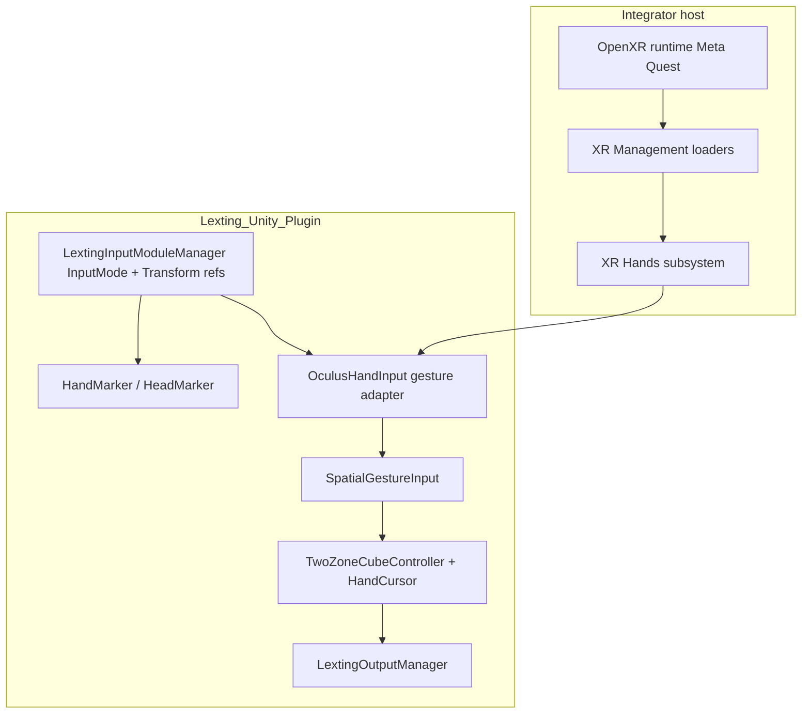

# ADR: XR integration — Quest, OpenXR, and input adapters

**Status:** Accepted (living document; **Milestone 3** target **`0.3.0`**)  
**Date:** 2026-11-04  
**Scope:** [`Lexting_Unity_Plugin`](../Lexting_Unity_Plugin/) + integrator host project (Unity **6000.0.60f1**, Android/Quest primary).

Related: [`implementation_plan.md`](implementation_plan.md) (Milestone 3), [`plugin_migration_map.md`](plugin_migration_map.md).

---

## Context

Lexting typing logic consumes **hand pose, gesture state, and wrist orientation** through a single façade, **`SpatialGestureInput`**. Platform code must supply those signals without forking the two-volume UI, dictionary, or output pipeline.

Historically the prototype used **Meta/Oculus Integration** assets (`OVRSkeleton`, embedded `Assets/Oculus/`). **Milestone 1** moved the monolith to **Unity 6** and validated **Quest 2** with **OpenXR + Meta Quest Support** while the reference rig uses **Unity XR Hands** (`HandVisualizer` on **`XRRig`**). **Milestone 2** extracted the same C# into the UPM package; device builds run from an integrator-style host that references **only** the package.

This ADR records **what ships today (`0.2.0`)**, the **M3 target (`0.3.0`)**, and what remains **legacy / disabled**.

---

## Decision summary

| Topic | Today (`0.2.0`) | Milestone 3 target (`0.3.0`) |
|--------|-----------------|------------------------------|
| **Quest Android loader** | **OpenXR** primary on the host; Meta Quest Support + hand tracking features enabled | Same; document loader order and required OpenXR features in one place (this ADR) |
| **Blessed integrator `InputMode`** | Reference scene **`main_01_twozone`** uses **`QUEST_HANDS`** (`mode: 0`) | **`OPEN_XR`** on reference scene; Meta/Oculus **XRRig + OpenXR loader** uses **`OPEN_XR`**, not **`QUEST_*`**. Enum **`QUEST_*`** kept until **M5** wizard removes picker + collapses enum. |
| **Hand adapter class** | **`OculusHandInput`** for **`QUEST_*`** only today | Rename **`OpenXRHandInput`**; attach for **`OPEN_XR`**; wire **`SpatialGestureInput`** subscriptions |
| **Embedded Oculus Integration** | **Not** in the package; **`com.unity.xr.oculus`** UPM only | Keep UPM; no bulk Integration copy in git |
| **Leap** | `#if LEXTING_FOUND_LEAP_SDK` | **Deprecate, do not delete**—template for future SDKs; Quest APK: define off + **`#if`** / **comment-out whole classes** so no Leap IL |
| **OVR skeleton fallback** | Inside **`#if LEXTING_FOUND_OCULUS_SDK`** on Android | **Deprecate, do not delete**—inactive on greenfield Quest APKs |
| **Scripting defines** | Postprocessor strips **`LEXTING_FOUND_OCULUS_SDK`** on **Android** | Quest shipping: **no** `LEXTING_FOUND_OCULUS_SDK`; **`OpenXRHandInput`** uses XR Hands path |

---

## Package and loader matrix

### Plugin `package.json` dependencies (API / compile surface)

Pinned in [`Lexting_Unity_Plugin/package.json`](../Lexting_Unity_Plugin/package.json) (host must resolve compatible versions):

| Package | Version (0.2.0) | Role in Lexting |
|---------|-----------------|-----------------|
| `com.unity.inputsystem` | 1.14.2 | Input System (host settings; legacy + XR pose controls as configured) |
| `com.unity.ugui` | 2.0.0 | Output UI (`InputField`, uGUI receivers) |
| `com.unity.xr.management` | 4.5.1 | XR plug-in management (loader list lives on **host**) |
| `com.unity.xr.openxr` | 1.15.1 | **Primary Quest loader**; hand tracking / Meta feature flags on host |
| `com.unity.xr.hands` | 1.5.0 | **`XRHandSubsystem`**, joint poses, **`HandVisualizer`** sample vendored under `Runtime/ThirdParty/XRHandsHandVisualizer/` |
| `com.unity.xr.interaction.toolkit` | 3.0.8 | XRI / rig patterns integrators may use alongside Lexting |
| `com.unity.xr.oculus` | 4.5.6 | Meta runtime support package (**not** a second copy of typing logic) |

**Not** listed in plugin dependencies: **`com.unity.pipeline`** (maintainer tooling only), embedded **UniRx / SimpleJSON / Surge** (vendored source).

### Host-only (integrator project)

The host **`Packages/manifest.json`** adds the Lexting package (`file:` or Git URL) and should **mirror** the XR/Input pins above. Additional host-only packages (e.g. **`com.unity.pipeline`**, Android logcat, IDE) do not ship inside the plugin.

**Android / Quest host settings (maintainer reference):**

- **XR Plug-in Management → Android:** **OpenXR** loader registered and enabled (optional legacy **Oculus** loader may exist but OpenXR is the build path under test).
- **OpenXR → Meta Quest Support** and **Hand Tracking** (Android + Standalone as needed).
- **Player:** `com.lexting.spatialgesturetext`, min SDK **24**, IL2CPP; **`USE_INPUT_SYSTEM_POSE_CONTROL`** when using Input System pose APIs.
- **Build settings:** `Packages/com.lexting.spatialgesturetext/Scenes/main_01_twozone.unity`.

Loader assets live under the host **`Assets/XR/`** tree (not in the UPM package).

---

## Runtime architecture

Typing and UI code **must not** reference platform SDKs directly except through the input adapter layer.

**Reference rig:** **`XRRig`** prefab (`Runtime/Prefabs/XRRig.prefab`) with vendored **`HandVisualizer`**, **`LextingController`**, left/right hand anchors. Scene: **`Scenes/main_01_twozone.unity`**.

---

## `InputMode` → wiring (`0.3.0`)

Enum: [`LextingInputModuleManager.cs`](../Lexting_Unity_Plugin/Runtime/Scripts/Input/LextingInputModuleManager.cs).

| `InputMode` | Reference scene | Head / hand refs | Adapter | `SpatialGestureInput` |
|-------------|-----------------|------------------|---------|------------------------|
| **`OPEN_XR`** | **Yes** (`mode: 4`) | **`head_OXR`**, **`rightHand_OXR`**, **`leftHand_OXR`** → XRRig | **`OpenXRHandInput`** on head | **`InitXrHandEventBindings()`** when **`usesOpenXrHandAdapter`** |
| **`QUEST_*`** | Obsolete (M5 removal) | Legacy `head_QH` / `*_QHP` / `*_QT` columns | Same **`OpenXRHandInput`** via **`usesOpenXrHandAdapter`** | Same |
| **`QUEST_TOUCH*`** | Legacy | `*_QT` / `*_QTP` | Touch types unmaintained | Touch handlers largely commented |
| **`LEAP_*`** | If **`LEXTING_FOUND_LEAP_SDK`** (Standalone) | Leap attachment transforms | **`LeapHandInput`** (deprecated) | Leap block in **`SpatialGestureInput.Awake`** |

Meta Quest + OpenXR loader: set **`OPEN_XR`**, not **`QUEST_*`**. See [`known_gaps.md`](known_gaps.md).

---

## `OpenXRHandInput` (M3 rename from `OculusHandInput`)

**Shipped in `0.3.0`:** [`OpenXRHandInput.cs`](../Lexting_Unity_Plugin/Runtime/Scripts/Input/OpenXR/OpenXRHandInput.cs) (renamed from **`OculusHandInput`**). OpenXR-era APIs:

- Android bind path prefers **`UnityEngine.XR.Hands`** + **`HandVisualizer`** joints (OpenXR hand subsystem under the hood on Quest).
- Optional **`OVRSkeleton`** fallback remains behind **`#if LEXTING_FOUND_OCULUS_SDK`** (legacy prefab path; stripped from typical Android defines).

**`OpenXRInputDescriptor`** is an empty scene **`Descriptor`** for in-editor documentation only—not a runtime input driver.

**Inheritance:** **`OpenXRHandInput`** and **`LeapHandInput`** do **not** share a common hand-input base class. Each is **`Singleton<T>`** with parallel event surfaces wired manually in **`SpatialGestureInput`**. The “one sibling per deployment target” shape is implemented as:

- duplicate **`InputMode`** values and **Transform** slots on **`LextingInputModuleManager`** (`head_QH` vs `head_OXR`, etc.), and  
- separate adapter **`MonoBehaviour`** types—not an OOP adapter hierarchy.

That duplication made sense when Quest (OVR), PC VR (OpenXR), and Leap were separate stacks. **M3 cleanup (recommended):**

1. **Rename** **`OculusHandInput`** → **`OpenXRHandInput`** (folder out of `OculusIntegration/`).
2. **Reference scene `InputMode.OPEN_XR`**. One head/hand Transform trio on the manager. **`QUEST_*`** enum kept until **M5** wizard removes mode picker entries and collapses enum.
3. **Generalize** **`SpatialGestureInput`**: e.g. **`InitHandEventBindings(IHandGestureAdapter)`** instead of **`InitOculusEventBindings()`** + Leap-specific blocks.
4. **Deprecate, do not delete** OVR skeleton fallback and **`SimpleOculusHandInput`** (reference only; greenfield Quest APKs typically compile without OVR path—see below).
5. **Optional:** introduce a small **`IHandGestureSource`** interface only if it reduces duplication; **do not** recreate a deep platform inheritance tree for XR—OpenXR is the default XR contract; **proprietary non-OpenXR hosts** (e.g. future Leap-like or Snap-like SDKs) add a **new adapter** that still binds **`LextingHand`** joints and publishes the same events into **`SpatialGestureInput`**.

**“Trim duplicate Transform columns”** means the **`LextingInputModuleManager`** Inspector fields (`head_QH`, `head_QHP`, `head_OXR`, `rightHand_QH`, …)—one serialized trio **per `InputMode` variant**—not **`HandMarker`** / **`HeadMarker`**. Markers stay: they are added at runtime on the **active** head/hand **`Transform`**s and feed cursor/palm logic. Refactor target: **one active head + left/right hand reference** (or a small struct) per scene, plus **`InputMode`** for streaming/desktop/Leap—not six parallel Quest/OpenXR copies of the same XRRig wiring.

**OVR skeleton fallback (when it runs):** On Android, the “XR Hands first, OVR second” block is inside **`#if LEXTING_FOUND_OCULUS_SDK`**. **`LextingDefineSymbolsPostprocessor`** removes that define on **Android**, so **greenfield Quest builds** typically take only the **`BindUnityXRHandNodes`** path (no OVR timeout fallback in the compiled player). Fallback remains for **Standalone** projects that still contain **`OVRSkeleton`** assets (e.g. old monolith workflows). Dropping the fallback is a **maintainer cleanup** once those projects are retired—not a behavior change for current **`tutorial_demo`** if XR Hands bind succeeds.

---

## Adapter behavior: `OculusHandInput` (Android / Quest)

File: [`OculusHandInput.cs`](../Lexting_Unity_Plugin/Runtime/Scripts/Input/OculusIntegration/OculusHandInput.cs).

Despite the name and folder (`OculusIntegration/`), the **shipping Quest path** is:

1. **`BindHandNodes`** (Android): prefer **Unity XR Hands** — wait for **`HandVisualizer`** hand clones, map joints via **`XrHandVisualizerUtility`** / palm normal helpers (`QuestHandPalmNormal`, `QuestHandRotationMapping`).
2. **Fallback:** **`OVRCustomSkeleton`** under hand anchors if present (legacy prefab path; not used by **`XRRig`** reference).
3. **Gesture logic:** transform-based grab / rotation / back-word detection (not OVR pinch APIs).

Supporting types: **`QuestHandBindingState`**, **`QuestHandCursorPosition`**, **`QuestEarlyOvrBootstrap`** (naming legacy), **`QuestHandRotationDebugSettings`** (device debug, default off).

---

## Scripting define symbols

| Symbol | Source | Android Quest build |
|--------|--------|---------------------|
| **`LEXTING_FOUND_OCULUS_SDK`** | [`LextingDefineSymbolsPostprocessor`](../Lexting_Unity_Plugin/Editor/Editor/LextingDefineSymbolsPostprocessor.cs) searches **`OVRSkeleton`** on Standalone; **stripped on Android** | Should remain **off** for greenfield Quest APKs (`tools/build_quest.ps1` guards against it) |
| **`LEXTING_FOUND_LEAP_SDK`** | Leap assets in project | **Off on Android Quest**; Leap sources wrapped in **`#if`**; **comment out entire classes/files** if any reference would still compile Leap into the player assembly |

---

## Legacy / out of scope for OpenXR Quest builds

| Item | Location | M3 action |
|------|----------|-----------|
| Bulk **`Assets/Oculus/`** Integration | Not in package | Do not reintroduce |
| **`Lexting_OVRCameraRig`** legacy prefabs | Monolith-only paths | Do not document as default |
| **MLAPI streaming** | Removed from M2 package scope | Replace with NGO in later milestone |
| **Leap Motion (reference)** | `Runtime/Scripts/Input/Leap/`, `#if LEXTING_FOUND_LEAP_SDK` | **Deprecated, retained**—not Quest shipping; use as integration template (see below) |
| **Touch controller modes** | `QUEST_TOUCH*` | Unmaintained; do not extend |
| **OVR skeleton / `SimpleOculusHandInput`** | `OculusHandInput` bind fallback | **Deprecated, retained** (reference); not in greenfield Quest player when define off |

---

## Integrating a new hand SDK (Leap as deprecated template)

Leap may never return as a supported product path; the in-package Leap tree is **maintained as documentation-by-example**, not deleted in M3.

**Quest APK exclusion:** Android Quest builds must **not** define **`LEXTING_FOUND_LEAP_SDK`**. Prefer **`#if LEXTING_FOUND_LEAP_SDK`** around entire Leap types; if any stray reference still compiles Leap into the player assembly, **comment out whole classes/files** until the dependency is gone. Confirm with a greenfield **`tools/build_quest.ps1`** APK (optional: player assembly inspection).

**Reference files:**

- **`LeapHandInput`** — singleton adapter: waits for vendor rig, assigns **`LextingHand`** joint transforms, raises gesture/rotation events.
- **`LextingLeap*Marker`** — vendor-specific helper components on the SDK hand hierarchy (collision/proximity → adapter methods).
- **`SpatialGestureInput.Awake`** — **`Subscribe(LeapHandInput.Instance…)`** block mirrors the Quest/OXR adapter wiring.

**Checklist for a future SDK (Snap, Leap-like competitor, etc.):**

1. Add **`#if LEXTING_FOUND_<VENDOR>_SDK`** (or asmdef reference) so Quest builds omit the code.
2. Implement **`VendorHandInput`** (name TBD): bind bones/transforms → **`Lexting.input` / `LextingHand`** struct on **`SpatialGestureInput`**.
3. Reuse or add **marker** scripts on the vendor prefab where proximity/orientation logic is cleaner than polling in Update.
4. Wire events into **`SpatialGestureInput`** (shared **`InitHandEventBindings`** when M3 generalizes subscriptions).
5. Extend **`InputMode`** only if the product needs a distinct streaming/desktop behavior—not one enum value per duplicate XRRig wiring.
6. Document packages, defines, and scene setup in this ADR; do **not** require embedded bulk vendor **`Assets/`** in the open package when UPM exists.

---

## Validation status

| Check | Status (2026-11-04) |
|-------|---------------------|
| Plugin + host compile Unity **6000.0.60f1** | Done |
| UPM XR pins aligned plugin ↔ host | Done |
| Quest APK built with OpenXR loader + **`main_01_twozone`** | Done (`tutorial_demo.apk` / build **001**, package **0.2.0**) |
| Full **M1 gesture checklist** on OpenXR + **`QUEST_HANDS`** stack | **Not** signed off (QA in progress vs monolith build **028**) |
| **`OPEN_XR`** mode end-to-end | **Not** implemented |
| Integrator/judge **known gaps** one-pager | Partial (README Architecture “Honest gap”; this ADR) |

---

## Consequences

- **Integrators** should install the package, configure **OpenXR + Meta Quest** on the host, wire **`LextingInputModuleManager`** to their rig (or future Setup Wizard), and match **`main_01_twozone`** until **`OPEN_XR`** is default.
- **Maintainers** implement M3 by closing the **`OPEN_XR`** gaps in **`LextingInputModuleManager`** / **`SpatialGestureInput`**, renaming or documenting **`OculusHandInput`** as the XR hand adapter, and re-running the M1 device checklist on the unified path.
- **Meta Start (`0.4.0` beta)** may ship on the interim stack (**OpenXR loader + `QUEST_HANDS` + XR Hands bind**) if **`0.3.0`** slips, only with this ADR updated and limitations called out in release notes.

---

## Changelog

| Date | Change |
|------|--------|
| 2026-11-04 | Initial ADR — documents `0.2.0` reality and `0.3.0` OpenXR-first target. |
| 2026-11-04 | Leap policy — deprecate in-package Leap adapter; **retain** as template for future hand SDK integration (M3). |
| 2026-11-04 | M3 go-ahead — **`OpenXRHandInput`**, scene **`OPEN_XR`**, single Transform trio; **`QUEST_*` → M5**; smoke + **0.3.0** release; OVR fallback deprecate-not-delete. |
